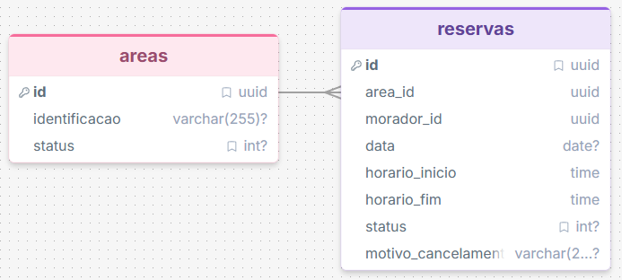
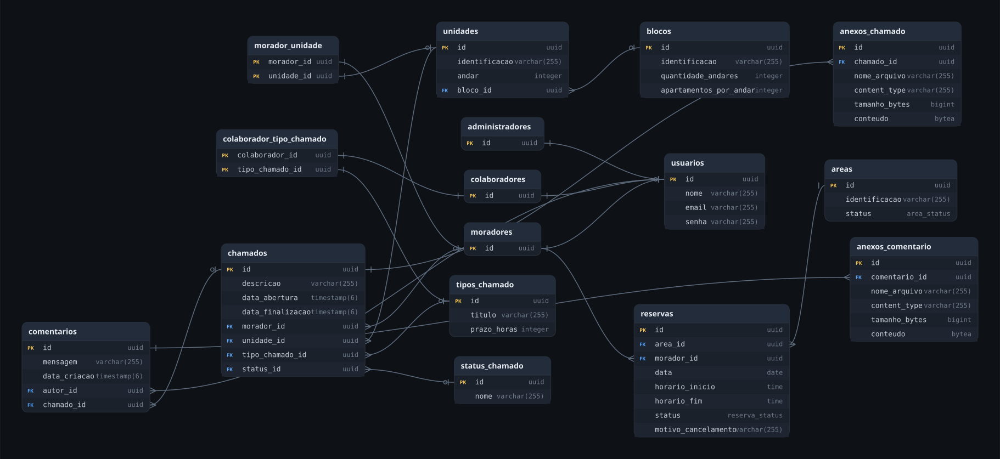

# Documentação das decisões

Começando com o planejamento das classes. Decidi que seriam utilizadas duas classes: Area e Reserva. Para os atributos e métodos dessas classes, precisei organizar os requisitos para que não tivesse retrabalho.

Após a leitura inicial da descrição da feature, eu escrevi essa estrutura:

<pre>
- Área (disponível: bool, status: {ativa, desativada, retirada})
{
	cadastrar()
}
- Reserva (
	área: Área
	data: Data
	inicioHora: Horário
	fimHora: Horário
	status: [solicitada, aprovada, negada, cancelada]
)
{
	// morador
	consultar(área, data, início, fim)
	solicitar(área, data, início, fim)
	// admin
	aprovar()
	negar()
	// misto (morador só as próprias e admin qualquer uma)
	visualizar()
	cancelar()
}
</pre>

Porém, esse modelo inicial ainda apresentava muitas incosistências, que só fui perceber ao longo do desenvolvimento.
Para as áreas, faltava o campo de identificação, e para a reservas, a chave estrangeira do morador e o motivo do cancelamento.

Esse é o esquema de classes finalizado para a nova feature.

Um ponto que gerou dúvida foi sobre o status da área, pois o RF-01 e a RN-01-01 mencionam áreas `DESATIVADAS` ou `RETIRADAS`, sem especificar se são status diferentes ou apenas sugestões de nomes, o que me fez adicionar esses dois valores ao status de Area. Atualmente, apenas os status `ATIVA` e `DESATIVADA` estão de fato em uso na aplicação, mas deixei o status de `RETIRADA`.

### O que ficou de fora?
Tratamento adequado de excessões. Quando testei o código inicial que recebi, percebi que as excessões fazem a página não carregar, ao invés de dar um feedback para o usuário. Esse é um problema grave que eu gostaria de resolver se tivesse mais tempo.

A funcionalidade de calendário. Devido ao tempo, decidi priorizar as funções básicas para o funcionamento da aplicação, isso é, a relação entre admnistradores, áreas, moradores e reservas.

### O processo
Após decidir quais novas classes seriam criadas para a feature, decidi começar com os endpoints para a entidade Área, por ser mais simples.

Primeiro criei a página para listar as áreas para o administrador. Em seguida criei os endpoints para listar, criar, atualizar e excluir a área, então os serviços para validar as regras de negócio. Tudo o que precisei fazer depois foi uma página para exibir os detalhes da área e permitir atualizar a identificação.

Para as reservas, foi mais complexo. O processo começou igual, com a página de listagem. Para os endpoints, precisei criar dois controllers: Um para as tarefas de administrador, e outra para as tarefas de morador.

### Inconsistências encontradas
A primeira coisa que verifiquei no código recebido, foram os testes. Percebi que todos estavam com os caminhos dos pacotes errados, então corrigi, além de adicionar as importações que faltavam.

### Uso de IA generativa
- Ferramentas: ChatGPT e Gemini
- Uso: Sugentão e validação dos casos de teste da nova funcionalidade

Pedi que o ChatGPT realizasse alguns testes com base nas regras estabelecidas no desafio. Pedi que o Gemini que identificasse falhas nos testes gerados.
Removi testes redundantes e que não seguiam os padrões do JUnit 5. Também reescrevi testes que não batiam com a arquitetura da aplicação.

Não usei IA para analisar os requisitos do desafio ou tomar decisões regras de negócio. Apenas para gerar casos de teste e consultar erros ligados a dependências do java.

### Novo diagrama
Foram adicionadas duas novas relações: Área e Reserva.
As reservas têm uma relação de [n..1] com os moradores e de [n..1] com as áreas. As tabelas e funções que já existiam não foram modificadas.
